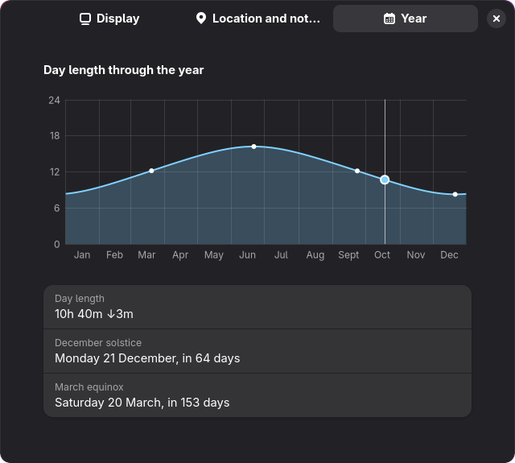

# Vesperal

**Tell time by the Sun, right in the GNOME top bar.**

Vesperal shows how long remains until the next sunrise or sunset, or how long since the last
one, next to the GNOME clock. A small arc shows where the Sun stands along the day, or the Moon
along the night.

[](https://extensions.gnome.org/extension/11329/vesperal/)


## Features

- ⏳ **Remaining or elapsed time, or both**: "3h 15m" until sunset, "42 min" since sunrise, or
  "42 min / 3h 15m" for both. It updates on the minute, in step with the GNOME clock.
- 🌅 **Sun arc**: the Sun by day and the Moon by night, placed at the progress of the day or night.
  The part of the arc that the displayed duration measures is drawn in full, so you can tell at
  a glance which one you are reading; with both, the whole arc is.
- 🌗 **Moon phase**: by night, the Moon shows its real phase, lit on the side you see it lit from
  your hemisphere. A new moon still shows as an outline.
- 📋 **Day details** in the menu, in your local time: dawn, sunrise, sunset and dusk; the length of
  the day or night; the other duration; and the location in use.
- 📈 **Day length trend**: next to the day length, whether days are getting longer or shorter, and
  by how much: "10h 43m ↓3m", or in seconds near a solstice ("↑45s").
- 📅 **The year at a glance**, in the preferences: the day length through the year as a chart, with
  today, the solstices and the equinoxes marked, and how far away the next ones are.
- 🌆 **Twilight of your choice** for dawn and dusk: civil, nautical or astronomical.
- 🌄 **Sunrise to sunset, or dawn to dusk**: count the day until it actually gets dark, if you
  prefer. With a deep twilight, summer nights may not get that dark for weeks, even at
  mid-latitudes: the top bar then says "No dark night".
- 🌍 **Anywhere on Earth**: polar days and polar nights are shown as such, with the date of the
  next sunrise or sunset.
- 📍 **Automatic or manual location**: follow the GNOME location services, or pick a city (searched
  offline) or any coordinates. If the location becomes unavailable, Vesperal keeps using the last
  known one.
- 🔔 **Notifications**, if you want them: a chosen number of minutes before dawn, sunrise, sunset or
  dusk, such as "Sunset in 30 min". Each event is announced once, even across a suspend or a
  screen lock, and they follow Do Not Disturb like any other notification.
- 📴 **Offline**: every computation runs on your computer, after the NOAA solar position algorithm.
- 🌐 **18 languages**: English and French, plus Catalan, Czech, Danish, Dutch, Finnish, German,
  Greek, Hungarian, Italian, Norwegian Bokmål, Polish, Portuguese, Romanian, Spanish, Swedish
  and Ukrainian.

## Installation

### From GNOME Extensions

Install Vesperal from [its page on extensions.gnome.org](https://extensions.gnome.org/extension/11329/vesperal/), or with the
Extension Manager app.

### From source

You need Node 24 or later and [pnpm](https://pnpm.io/).

```sh
git clone https://github.com/kornifex/vesperal.git
cd vesperal
pnpm install
pnpm --filter @vesperal/gnome-extension install-extension
```

Log out and back in, then enable the extension:

```sh
gnome-extensions enable vesperal@kornifex.github.io
```

## Usage

| Action | Effect |
|---|---|
| Click the indicator | Open the menu with the day details |
| Right-click the indicator | Switch to the next Reading: remaining time, elapsed time, both |
| Menu → Preferences | Open the preferences |

| By day, remaining time | By night, elapsed time |
|---|---|
|  |  |

The part of the arc drawn in full is the part the duration measures: the way ahead of the Sun
for remaining time, the way behind the Moon for elapsed time, the whole arc for both.

## Preferences


| Page | Setting | Choices | Default |
|---|---|---|---|
| Display | Reading | Remaining time, elapsed time, elapsed and remaining time | Remaining time |
| Display | Content | Sun arc and duration, Sun arc only, duration only | Sun arc and duration |
| Display | Sun arc | Left or right of the duration, when both are shown | Left |
| Display | Position | Next to the clock, left side or right side of the top bar | Next to the clock |
| Display | Twilight | Civil (6°), nautical (12°), astronomical (18°) | Civil |
| Display | Day and night | From sunrise to sunset, or from dawn to dusk | From sunrise to sunset |
| Location and notifications | Mode | Automatic, or a manual city or coordinates | Automatic |
| Location and notifications | Notifications | On or off | Off |
| Location and notifications | Events | Any of dawn, sunrise, sunset and dusk | Sunset |
| Location and notifications | Minutes before | 0 (at the event) to 180 | 30 |

Changes apply immediately. With no location known, the preferences open on the Location and
notifications page.

The Year page charts the day length through the current year at the location in use, counted
from sunrise to sunset or from dawn to dusk as chosen, and gives today's day length and the
dates of the next solstice and equinox. It moves on to the next day at midnight, even with the
window left open. The preferences never ask the system where you are: in automatic mode, the
Year page uses the last known location.



## Privacy

- In **automatic** mode, Vesperal asks GNOME's location service (GeoClue) for a city-level
  position, and only while the location services are switched on in the system settings.
- In **manual** mode, Vesperal never asks the system where you are.
- The city search uses the database that ships with GNOME, so it works offline.
- Notifications are made on your computer and go to the GNOME notification list only.
- Vesperal itself makes no network requests. Your settings and last known location stay in your
  local GNOME settings.

## Compatibility

GNOME Shell 49, 50 and 51.

## Changelog

Versions are numbered by extensions.gnome.org.

### Unreleased

- ⏳ **Elapsed and remaining time at once**: a third Reading shows both in the top bar,
  "42 min / 3h 15m", with the whole Sun arc drawn in full. Right-click the indicator to go
  through the three.
- 🕒 **12-hour or 24-hour times**: the times in the menu and in notifications now follow the format
  of the GNOME clock (*Settings → System → Date & Time → Time Format*), rather than the habit of
  the locale alone.

### Version 3 (19 October 2026)

- 🌗 **Moon phase**: by night, the Moon on the arc shows its real phase, as seen from your
  hemisphere.
- 🔔 **Notifications** ahead of dawn, sunrise, sunset or dusk, a chosen number of minutes before.
- 🌄 **Sunrise to sunset, or dawn to dusk**: the day can be counted until it actually gets dark,
  with "No dark night" when it does not for over 24 hours.
- 📈 **Day length trend** next to the day length: "10h 43m ↓3m".
- 📅 **Year page** in the preferences, charting the day length through the year with the solstices
  and equinoxes.
- 🧩 **Top bar content and position**: show the Sun arc, the duration or both, next to the clock or
  at either side of the top bar.
- ⚙️ **Preferences in pages**: Display, Location and notifications, and Year.
- 🌐 **16 more languages**, machine-translated and awaiting review.
- 🖥️ **GNOME Shell 49 and 51**, as well as 50.
- 🎨 A new logo in black and white, and a smaller Sun and Moon on the arc.

### Version 2 (17 October 2026)

The first published version.

- ⏳ The remaining or elapsed time until the next sunrise or sunset in the top bar, updated on the
  minute.
- 🌅 The Sun arc, with the Sun by day and the Moon by night, its measured part drawn in full, on
  the side of the duration you choose.
- 🖱️ A right-click on the indicator to switch between remaining and elapsed time.
- 📋 The day details in the menu: dawn, sunrise, sunset and dusk, the length of the day or night,
  the other duration and the location in use.
- 🌆 Civil, nautical or astronomical twilight.
- 🌍 Polar days and polar nights, named as such.
- 📍 Automatic location from the GNOME location services, with the last known location as a
  fallback, or a manual city (searched offline) or coordinates.
- 🌐 English and French, on GNOME Shell 50.

## Translations

Vesperal is translated with gettext. English is the source language. The French translation is
the author's. The other languages are machine translations awaiting review by native speakers:
corrections are very welcome.

To add a language, copy `packages/gnome-extension/po/vesperal.pot` to
`packages/gnome-extension/po/<language>.po`, translate every message, and open a pull request.
`pnpm check` fails if any message is left untranslated.

## Development

```sh
pnpm install
pnpm check                                                  # lint, typecheck and tests (also a pre-commit hook)
pnpm format                                                 # apply Biome formatting
pnpm build                                                  # build the extension into packages/gnome-extension/dist
pnpm --filter @vesperal/gnome-extension install-extension   # build and install locally
pnpm --filter @vesperal/gnome-extension pack-extension      # build the zip for extensions.gnome.org
pnpm --filter @vesperal/gnome-extension update-po           # refresh po/ after changing messages
```

The repository is a pnpm monorepo:

- `packages/core`: solar computation, Phase model and presentation (what the bar and the menu
  show). It never imports GNOME libraries, so other front ends can reuse it.
- `packages/gnome-extension`: the GNOME Shell extension. It renders what the core computes.

`GLOSSARY.md` defines the domain language, and `docs/adr/` records the design decisions.

To try the extension without logging out, run a nested GNOME Shell session:

```sh
dbus-run-session gnome-shell --devkit --wayland
```

On Fedora, this needs the `mutter-devkit` and `dbus-daemon` packages.

### Authorship and AI assistance

Vesperal is designed and directed by its author, Julien Seren-Rosso. What the extension does,
how it looks and behaves, and every design decision come from the author. Each change was tried
on GNOME Shell by the author, then accepted or sent back for rework.

An AI coding assistant, Claude Code by Anthropic, helped write and refactor the code under that
direction, and drafted the translations other than French.

## License

[GPL-3.0-or-later](LICENSE).
