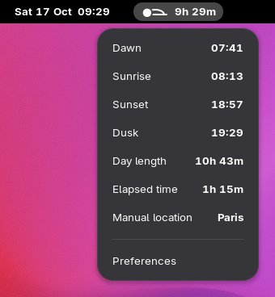
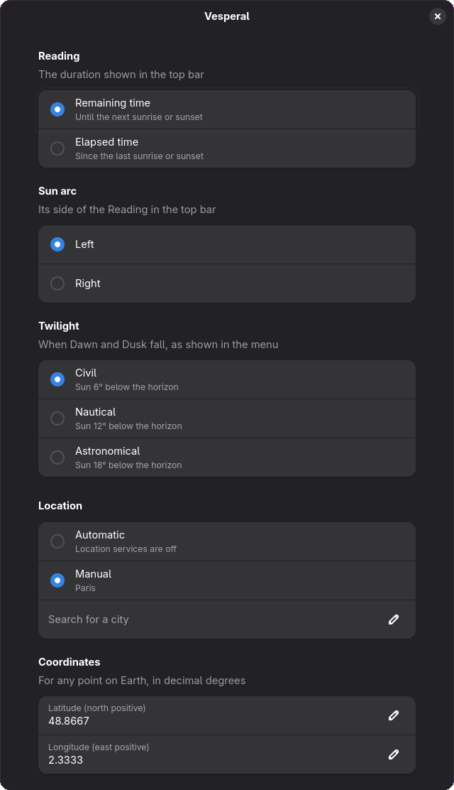

# Vesperal

**Tell time by the Sun, right in the GNOME top bar.**

Vesperal shows how long remains until the next sunrise or sunset, or how long since the last
one, next to the GNOME clock. A small arc shows where the Sun stands along the day, or the Moon
along the night.

<!-- TODO: point the badge at the extension's page once it is published. -->
[](https://extensions.gnome.org/)



## Features

- **Remaining or elapsed time**: "3h 15m" until sunset, or "42 min" since sunrise. It updates on
  the minute, in step with the GNOME clock.
- **Sun arc**: the Sun by day and the Moon by night, placed at the progress of the day or night.
  The part of the arc that the displayed duration measures is drawn in full, so you can tell at
  a glance which one you are reading.
- **Day details** in the menu, in your local time: dawn, sunrise, sunset and dusk; the length of
  the day or night; the other duration; and the location in use.
- **Twilight of your choice** for dawn and dusk: civil, nautical or astronomical.
- **Anywhere on Earth**: polar days and polar nights are shown as such, with the date of the
  next sunrise or sunset.
- **Automatic or manual location**: follow the GNOME location services, or pick a city (searched
  offline) or any coordinates. If the location becomes unavailable, Vesperal keeps using the last
  known one.
- **Offline**: every computation runs on your computer, after the NOAA solar position algorithm.
- **English and French**.

## Installation

### From GNOME Extensions

Install Vesperal from [extensions.gnome.org](https://extensions.gnome.org/), or with the
Extension Manager app.

### From source

You need Node 24 or later and [pnpm](https://pnpm.io/).

```sh
git clone https://github.com/kornifex/vesperal.git
cd vesperal
pnpm install
pnpm --filter @vesperal/gnome-extension install-extension
```

Log out and back in, then enable the extension:

```sh
gnome-extensions enable vesperal@kornifex.github.io
```

## Usage

| Action | Effect |
|---|---|
| Click the indicator | Open the menu with the day details |
| Right-click the indicator | Switch between remaining and elapsed time |
| Menu → Preferences | Open the preferences |

| By day, remaining time | By night, elapsed time |
|---|---|
|  |  |

The part of the arc drawn in full is the part the duration measures: the way ahead of the Sun
for remaining time, the way behind the Moon for elapsed time.

## Preferences



| Setting | Choices | Default |
|---|---|---|
| Reading | Remaining time, elapsed time | Remaining time |
| Sun arc | Left or right of the duration | Left |
| Twilight | Civil (6°), nautical (12°), astronomical (18°) | Civil |
| Location | Automatic, or a manual city or coordinates | Automatic |

Changes apply immediately.

## Privacy

- In **automatic** mode, Vesperal asks GNOME's location service (GeoClue) for a city-level
  position, and only while the location services are switched on in the system settings.
- In **manual** mode, Vesperal never asks the system where you are.
- The city search uses the database that ships with GNOME, so it works offline.
- Vesperal itself makes no network requests. Your settings and last known location stay in your
  local GNOME settings.

## Compatibility

GNOME Shell 50.

## Translations

Vesperal is translated with gettext. English is the source language, and French ships with it.

To add a language, copy `packages/gnome-extension/po/vesperal.pot` to
`packages/gnome-extension/po/<language>.po`, translate every message, and open a pull request.
`pnpm check` fails if any message is left untranslated.

## Development

```sh
pnpm install
pnpm check                                                  # lint, typecheck and tests (also a pre-commit hook)
pnpm format                                                 # apply Biome formatting
pnpm build                                                  # bundle the extension into packages/gnome-extension/dist
pnpm --filter @vesperal/gnome-extension install-extension   # build and install locally
pnpm --filter @vesperal/gnome-extension update-po           # refresh po/ after changing messages
```

The repository is a pnpm monorepo:

- `packages/core`: solar computation, Phase model and presentation (what the bar and the menu
  show). It never imports GNOME libraries, so other front ends can reuse it.
- `packages/gnome-extension`: the GNOME Shell extension. It renders what the core computes.

`GLOSSARY.md` defines the domain language, and `docs/adr/` records the design decisions.

To try the extension without logging out, run a nested GNOME Shell session:

```sh
dbus-run-session gnome-shell --devkit --wayland
```

On Fedora, this needs the `mutter-devkit` package.

## License

[GPL-3.0-or-later](LICENSE).
